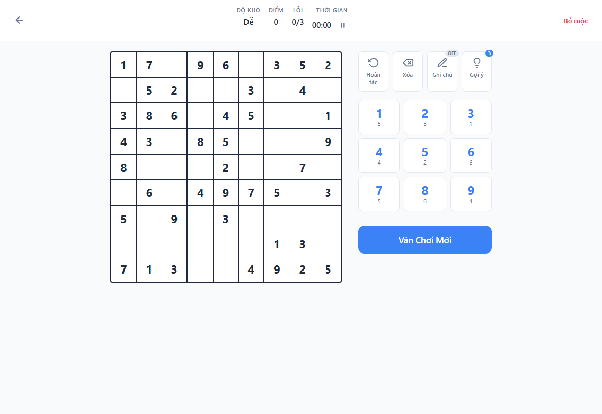
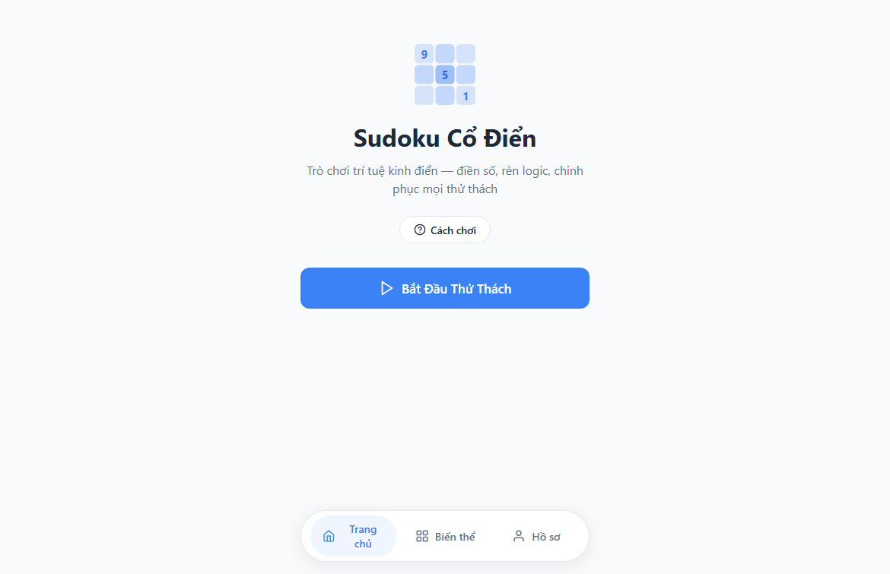
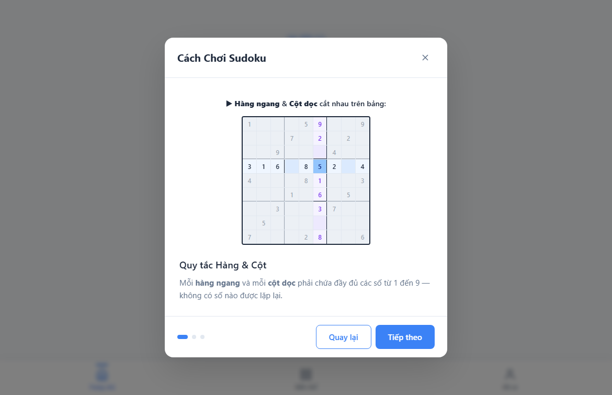
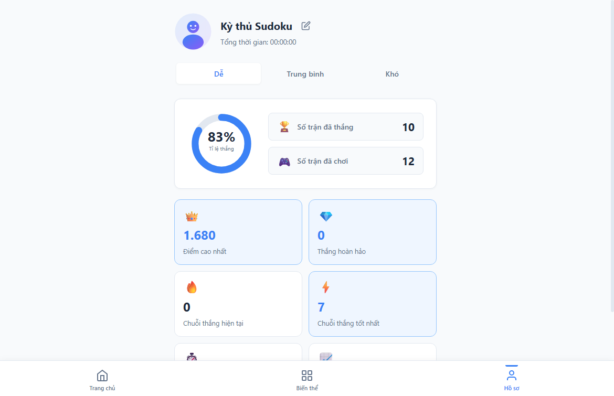

# 🧩 Sudoku Web App

<p align="center">
  <b>Trải nghiệm giải đố trí tuệ kinh điển với giao diện hiện đại, mượt mà và tối giản.</b>
  <br>
  <i>Xây dựng 100% bằng HTML5, CSS3 và Vanilla JavaScript - Tinh gọn, thuần khiết, không phụ thuộc thư viện.</i>
</p>

<p align="center">
  <a href="https://github.com/Jhanh/Sudoku_game/releases/tag/v1.0">
    
  </a>
  &nbsp;
  <a href="https://jhanh.github.io/Sudoku_game/">
    
  </a>
  &nbsp;
  <a href="https://github.com/Jhanh/Sudoku_game/archive/refs/heads/main.zip">
    
  </a>
</p>

<p align="center">
  
  
  
  
  
</p>

---

## 🌟 Trải Nghiệm Hình Ảnh (Showcase)

<p align="center">
  
  &nbsp;
  
</p>
<p align="center">
  
  &nbsp;
  
</p>

---

## ✨ Điểm Nổi Bật Của Sản Phẩm

* 🧠 **Đề Bài Chuẩn Quốc Tế:** Thuật toán tạo đề thông minh với **duy nhất 1 lời giải** cho mỗi ván chơi. Hỗ trợ 3 cấp độ phù hợp cho mọi đối tượng từ người mới đến cao thủ:
  * **Dễ (Easy):** 38 – 45 ô cho trước — Thư giãn, giải trí nhẹ nhàng.
  * **Trung bình (Medium):** 30 – 35 ô cho trước — Rèn luyện khả năng suy đoán.
  * **Khó (Hard):** 24 – 28 ô cho trước — Cân não, đòi hỏi kỹ thuật giải chuyên sâu.
* 🎨 **Giao Diện Thanh Lịch & Thân Thiện:** Tối ưu hóa thị giác với gam màu Indigo dịu mắt, hiệu ứng Highlight thông minh (tự động chiếu sáng hàng, cột, khối 3x3 và làm nổi bật các con số tương đồng trên toàn bàn đấu).
* 🛠️ **Bộ Công Cụ Hỗ Trợ Đắc Lực:**
  * **Ghi Chú Nháp (Pencil Notes):** Điền số nháp linh hoạt, tự động làm sạch số nháp trùng khi chốt đáp án.
  * **Hoàn Tác & Xóa (Undo / Erase):** Sửa sai tức thì mà không lo gián đoạn mạch tư duy.
  * **Gợi Ý Thông Minh (Hint):** Trợ giúp giải ô hóc búa kèm hiệu ứng tỏa sáng.
  * **Bàn Phím Số Kèm Bộ Đếm:** Lưới phím 3x3 hiển thị số lượng con số còn thiếu, tự động làm mờ khi đã điền đủ 9 số.
* 🎓 **Hướng Dẫn Tương Tác Trực Quan:** Chế độ Hướng dẫn 3 bước với hình ảnh động chuyển động ngay trên lưới cờ, giúp người chơi nắm vững quy tắc cơ bản chỉ sau 1 phút.
* 📈 **Hồ Sơ & Thống Kê Toàn Diện:** Lưu trữ thành tích cá nhân, tính toán tỉ lệ thắng, chuỗi trận bất bại và thời gian giải nhanh nhất qua biểu đồ trực quan.
* ⚡ **Thuần Khiết & Tiện Lợi (Zero Dependencies):** Không cần cài đặt thư viện nặng nề, không cần môi trường lập trình phức tạp. Nhấp đúp chuột là chơi ngay trên mọi thiết bị và trình duyệt.
* 💾 **Tự Động Lưu Trạng Thái (Zero-Loss):** Tự động ghi nhớ ván chơi dở dang. Bạn có thể yên tâm đóng trình duyệt và quay lại tiếp tục bất kỳ lúc nào.

---

## 🚀 Cách Bắt Đầu Chơi Ngay

### 🌐 Cách 1: Chơi trực tiếp trên trình duyệt
Bạn có thể truy cập và chơi ngay không cần tải gì tại:
👉 **[https://jhanh.github.io/Sudoku_game/](https://jhanh.github.io/Sudoku_game/)**

### 💻 Cách 2: Tải về chơi Offline trên máy tính
1. Tải tệp nén **[Sudoku-Game-v1.0.zip](https://github.com/Jhanh/Sudoku_game/archive/refs/heads/main.zip)** về máy tính.
2. Giải nén thư mục.
3. Nhấp đúp vào tệp **`ChoiGame.bat`** (trên Windows) hoặc mở trực tiếp tệp **`index.html`** bằng trình duyệt web yêu thích của bạn.

### 🛠️ Cách 3: Chạy bằng máy chủ nội bộ Python (Dành cho Lập trình viên)
```bash
# Mở Terminal tại thư mục dự án và gõ:
python server.py
```
> Trình duyệt sẽ tự động mở trang web tại địa chỉ `http://localhost:3000`.

---

## ⌨️ Phím Tắt Thao Tác Nhanh

| Phím Tắt | Chức Năng |
| :--- | :--- |
| `1` – `9` | Điền số vào ô được chọn (hoặc điền số nháp) |
| `Backspace` / `Delete` | Xóa số trong ô |
| `Ctrl + Z` | Hoàn tác nước đi trước đó |
| `N` | Bật / Tắt chế độ Ghi chú nháp (Notes) |
| `H` | Nhận gợi ý (Hint) cho ô hiện tại |
| `↑` `↓` `←` `→` | Di chuyển ô chọn trên bàn cờ 9x9 |

---

## 📁 Cấu Trúc Thư Mục Dự Án (Project Structure)

```text
Sudoku_game/
├── index.html                 # Giao diện chính và cấu trúc DOM ứng dụng
├── server.py                  # Máy chủ tĩnh nội bộ Python (Auto port + No-cache)
├── README.md                  # Tài liệu giới thiệu sản phẩm & hướng dẫn
├── LICENSE                    # Giấy phép bản quyền mã nguồn mở MIT
├── .gitignore                 # Danh sách tệp loại trừ không lưu trên Git
├── docs/                      # Hệ thống tài liệu kỹ thuật toàn diện cho Dev & AI
│   ├── 01_project_overview.txt         # Tổng quan, triết lý, cây thư mục & cách chạy
│   ├── 02_architecture_and_modules.txt # Kiến trúc SPA & chi tiết 9 module JavaScript
│   ├── 03_game_logic_and_rules.txt     # Chi tiết quy tắc tính điểm, combo, phạt & Game Over
│   ├── 04_ui_ux_design_system.txt      # Bảng màu, typography, responsive, hiệu ứng cảnh báo
│   ├── 05_dev_guidelines_and_notes.txt # Những lưu ý sống còn, quy chuẩn commit, quy tắc Git
│   └── 06_css_styling_and_architecture.txt # Phân tích chuyên sâu toàn diện 6 file CSS độc lập
├── screenshots/               # Thư viện hình ảnh giao diện thực tế
│   └── preview.png            # Ảnh chụp giao diện thực tế
├── css/
│   ├── main.css               # Reset CSS, hệ thống màu, chuyển màn hình
│   ├── splash.css             # Giao diện & hoạt ảnh Màn hình Khởi đầu
│   ├── lobby.css              # Giao diện Sảnh chính, Menu, thẻ ván dở
│   ├── gameplay.css           # Bảng 9x9, bàn phím số, cảnh báo nguy hiểm
│   ├── modals.css             # Hộp thoại Hướng dẫn, Bảng điểm chi tiết, Game Over
│   └── profile.css            # Hồ sơ, biểu đồ Donut Chart, 6 thẻ thành tích
└── js/
    ├── storage.js             # Lớp lưu trữ LocalStorage & Memory Fallback
    ├── sudoku-engine.js       # Thuật toán sinh đề & giải Sudoku độc bản
    ├── game.js                # Quản lý ván chơi, bộ đếm giờ, lỗi, hoàn tác
    ├── ui-board.js            # Render bàn cờ, highlight hàng/cột/khối
    ├── ui-controls.js         # Bàn phím số, công cụ phụ trợ, cảnh báo đỏ
    ├── tutorial.js            # Quản lý các bước hướng dẫn động
    ├── variants.js            # Danh sách thông tin 4 biến thể Sudoku
    ├── profile.js             # Xử lý thống kê và vẽ biểu đồ tỉ lệ thắng
    └── app.js                 # Điều hướng và khởi động ứng dụng
```

---

## 📄 Bản Quyền & Giấy Phép (License)

Dự án được phân phối dưới giấy phép mã nguồn mở **MIT License**. Bạn được tự do học tập, sử dụng và phát triển thêm.
