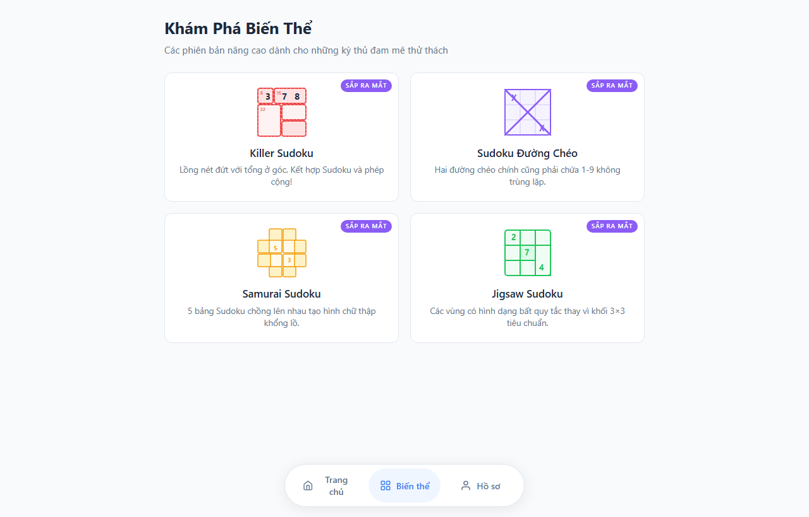

# 🧩 Sudoku Web — Phiên Bản Tối Ưu Hóa 100% Cho PC

<p align="center">
  <b>Trải nghiệm giải đố trí tuệ kinh điển với giao diện chuyên biệt cho máy tính (PC / Laptop), mượt mà và tối giản.</b>
  <br>
  <i>Xây dựng 100% bằng HTML5, CSS3 và Vanilla JavaScript — Tinh gọn, thuần khiết, Web Audio procedural SFX, không phụ thuộc bất kỳ thư viện ngoài nào.</i>
</p>

<p align="center">
  <a href="https://github.com/Jhanh/Sudoku_game/releases/tag/v1.1">
    
  </a>
  &nbsp;
  <a href="https://jhanh.github.io/Sudoku_game/">
    
  </a>
  &nbsp;
  <a href="https://github.com/Jhanh/Sudoku_game/archive/refs/heads/main.zip">
    
  </a>
</p>

<p align="center">
  
  
  
  
  
  
</p>

---

## 🌟 Trải Nghiệm Hình Ảnh (Showcase)

<p align="center">
  
  &nbsp;
  
</p>
<p align="center">
  
  &nbsp;
  
</p>

---

## ⚡ Điểm Khác Biệt & Độc Đáo So Với Các Web Sudoku Khác

Không giống như các trang web Sudoku thông thường sao chép giao diện di động thô sơ hay sử dụng thuật toán đào lỗ ngẫu nhiên, **Sudoku Web v2.0** được kiến tạo từ đầu nhằm mang lại trải nghiệm thi đấu trí tuệ đỉnh cao trên máy tính:

* 🧠 **Thuật Toán Sinh Đề Phân Loại Bằng Tư Duy Con Người (Human-Solving Logical Grader):**
  * **Không đào lỗ theo số lượng ô ngẫu nhiên:** Thay vì chỉ đếm số ô trống đơn thuần, bộ động cơ thẩm định câu đố dựa trên chính kỹ thuật giải thực tế của con người:
    * **Dễ (Easy - 36-40 ô gợi ý):** Đảm bảo giải được 100% chỉ bằng *Naked Singles* (ô có 1 ứng viên duy nhất) và *Hidden Singles* (chữ số có 1 vị trí duy nhất trong hàng/cột/khối).
    * **Trung bình (Medium - 30-34 ô gợi ý):** Đòi hỏi kỹ thuật loại trừ cấp trung như *Pointing Pairs / Box-Line Reduction* và *Naked Pairs* (cặp ô đôi).
    * **Khó (Hard - 24-28 ô gợi ý):** Cực hạn bài toán Sudoku quốc tế, duy nhất 1 nghiệm (Unique Solution), đòi hỏi chuỗi tư duy nâng cao (*Hidden Pairs, Naked Triples, X-Wing*).
  * **Tốc độ sinh đề tức thì:** < 50ms nhờ cấu trúc bitmask tăng tốc, không gây đơ lag trình duyệt.

* ⚡ **Chế Độ Điền Nhanh "Tia Chớp" (Lightning Mode - Digit-First):**
  * Thao tác thần tốc cho kỳ thủ giải tốc độ: Chọn một chữ số để khóa, sau đó nhấp điền liên tục vào nhiều ô trống trên bàn cờ. Bấm vào bất kỳ số nào trên bàn cờ để chuyển ngay sang số đó. Khi đủ 9 ô, hệ thống tự động hoàn tất và chờ chọn số kế tiếp.
  * **Giao diện trực quan:** Phím số được chọn giữ màu sắc chuẩn (`.locked-digit`), các phím còn lại tự động mờ nhẹ (`.dimmed`), các số đã điền đủ 9 ô giữ màu xám hoàn thành (`.completed`) và được bảo vệ chống bấm nhầm.
  * Bật/tắt linh hoạt bằng nút Tia chớp ⚡ trên thanh công cụ hoặc phím tắt `F`.

* 🔊 **Hệ Thống Âm Thanh Procedural SFX Thuần Khiết (Zero Audio Files):**
  * Khác biệt hoàn toàn với các web Sudoku tĩnh lặng hoặc phải tải hàng megabyte file mp3: 100% âm thanh được tổng hợp sóng âm trực tiếp thời gian thực qua **Web Audio API** (10 âm thanh xúc giác: tiếng gõ gỗ thanh mảnh, đàn Marimba thăng hoa theo chuỗi Combo, khải hoàn ca chiến thắng...).
  * 0 byte dung lượng nạp ngoài, độ trễ bằng 0, phản hồi tức thì theo từng mili-giây.

* 🏆 **Thang 9 Cấp Bậc Danh Hiệu Chuẩn Mực (Mastery Points - Không Lạm Phát Cày Cuốc):**
  * Tôn vinh kỳ thủ thực thụ từ 🥋 **Nhập Môn** đến 🌟 **Huyền Thoại Sudoku** dựa trên điểm tích lũy thi đấu thực chất (kỹ năng giải đúng, chuỗi combo, thưởng tốc độ, thưởng thắng hoàn hảo 0 lỗi).
  * Thiết kế Dashboard Hồ sơ 2 cột chuyên biệt cho PC, hiển thị toàn bộ biểu đồ Donut tỷ lệ thắng, kỷ lục và tiến trình cấp bậc trong **đúng 1 màn hình duy nhất — Tuyệt đối không cần cuộn trang**.

* 🛡️ **Kiến Trúc Thuần Khiết 100% & Trải Nghiệm Máy Tính Tối Đa (Zero Dependencies):**
  * Thuần khiết HTML5, CSS3, Vanilla ES6+ — không React/Vue nặng nề, không bundler, mở lên là chạy ngay trong chớp mắt.
  * Tích hợp Song ngữ tức thì (**Tiếng Việt 🇻🇳 / English 🇬🇧**), Chế độ Tối dịu mắt (**Dark Mode Slate Navy**) và bộ cảnh báo thân thiện khi vô tình mở trên màn hình điện thoại.

---

## 📦 Lịch Sử Phiên Bản (Release Notes)

* **🚀 v2.0 — Kỷ Nguyên Đột Phá Cốt Lõi & Trải Nghiệm Kỳ Thủ (Phiên Bản Hiện Tại):**
  * **Động cơ sinh đề Logic Grader:** Phân loại độ khó theo kỹ thuật giải đố của con người (Singles, Pairs, Box-Line, X-Wing) thay vì đếm số ô ngẫu nhiên.
  * **Chế độ Điền nhanh Chọn số trước (⚡ Digit-First Mode):** Khóa số điền liên tục, hỗ trợ phím tắt `F`, numpad mờ/sáng thông minh, tùy chọn mặc định trong Settings.
  * **Cải tiến hệ thống phạt sai:** Phạt lũy kế theo $n$ lần sai (-5/-15/-30, -7/-20/-40, -10/-30) cùng 2 cơ chế Game Over tức thì (chạm trần tổng lỗi hoặc chạm trần chuỗi sai liên tiếp).
  * **Tinh giản màn hình kết thúc ván:** Bãi bỏ bảng kê chi tiết rườm rà, tập trung làm nổi bật Tổng Điểm Đạt Được và các hành động thi đấu.
  * **Tái cân bằng 9 Cấp Bậc Danh Hiệu:** Ngưỡng điểm chuẩn mực (tối đa 3.000.000 điểm cho bậc Huyền Thoại ~1.000 ván đỉnh cao).
* **✨ v1.1 — Trợ Năng Giải Đố & Cá Nhân Hóa:**
  * Bổ sung Hộp thoại Cài Đặt hệ thống (Settings Modal) với 4 công tắc trợ năng (Tự xóa nháp, Đánh dấu số trùng, Báo lỗi ngay).
  * Hỗ trợ Song ngữ đa quốc gia (Bilingual i18n Việt - Anh).
  * Chế độ giao diện Tối dịu mắt (Eye-Friendly Dark Mode Slate Navy).
  * Hệ thống âm thanh Web Audio procedural 10 hiệu ứng chuyên biệt.
* **🌱 v1.0 — Bản Phát Hành Nền Tảng Đầu Tiên:**
  * Bàn cờ Sudoku 9×9 tối ưu chuẩn PC với 3 cấp độ khó cơ bản.
  * Hệ thống tính điểm thời gian thực, chuỗi combo liên hoàn và 4 biến thể Sudoku nổi tiếng thế giới.

---

## 🚀 Cách Bắt Đầu Chơi Ngay

### 🌐 Cách 1: Chơi trực tiếp trên trình duyệt
Bạn có thể truy cập và chơi ngay không cần cài đặt tại:
👉 **[https://jhanh.github.io/Sudoku_game/](https://jhanh.github.io/Sudoku_game/)**

### 💻 Cách 2: Tải về chơi Offline trên máy tính
1. Tải tệp nén **[Sudoku-Game-v1.1.zip](https://github.com/Jhanh/Sudoku_game/releases/tag/v1.1)** về máy tính.
2. Giải nén thư mục.
3. Nhấp đúp vào tệp **`ChoiGame.bat`** (trên Windows) hoặc mở trực tiếp tệp **`index.html`** bằng trình duyệt web yêu thích của bạn.

### 🛠️ Cách 3: Chạy bằng máy chủ nội bộ Python (Dành cho Lập trình viên)
```bash
# Mở Terminal tại thư mục dự án và gõ:
python server.py
```
> Trình duyệt sẽ tự động mở trang web tại địa chỉ `http://localhost:3000`.

---

## ⌨️ Phím Tắt Thao Tác Nhanh (Bàn Phím PC)

| Phím Tắt | Chức Năng |
| :--- | :--- |
| `1` – `9` | Điền số vào ô được chọn (hoặc chọn/khóa số trong chế độ Tia chớp) |
| `F` | Bật / Tắt chế độ Tia chớp - Điền liên tiếp (Lightning Mode) |
| `N` | Bật / Tắt chế độ Ghi chú nháp (Pencil Notes) |
| `Backspace` / `Delete` | Xóa số trong ô |
| `Ctrl + Z` | Hoàn tác nước đi trước đó (Undo) |
| `H` | Nhận gợi ý (Hint) cho ô hiện tại |
| `Space` / `P` | Tạm dừng ván đấu |
| `↑` `↓` `←` `→` | Di chuyển ô chọn trên bàn cờ 9x9 |

---

## 📁 Cấu Trúc Thư Mục Dự Án (Project Structure)

```text
Sudoku_game/
├── index.html                 # Giao diện chính và cấu trúc DOM ứng dụng
├── server.py                  # Máy chủ tĩnh nội bộ Python (Auto port + No-cache)
├── README.md                  # Tài liệu giới thiệu sản phẩm & hướng dẫn
├── LICENSE                    # Giấy phép bản quyền mã nguồn mở MIT
├── .gitignore                 # Danh sách tệp loại trừ không lưu trên Git
├── docs/                      # Hệ thống tài liệu kỹ thuật toàn diện cho Dev & AI
│   ├── 01_project_overview.txt         # Tổng quan, triết lý, cây thư mục & cách chạy
│   ├── 02_architecture_and_modules.txt # Kiến trúc SPA & chi tiết các module JavaScript
│   ├── 03_game_logic_and_rules.txt     # Chi tiết quy tắc tính điểm, combo, phạt & Game Over
│   ├── 04_ui_ux_design_system.txt      # Bảng màu, typography, bố cục PC Desktop, cảnh báo
│   ├── 05_dev_guidelines_and_notes.txt # Những lưu ý sống còn, quy chuẩn commit, quy tắc Git
│   ├── 06_css_styling_and_architecture.txt # Phân tích chuyên sâu 6 file CSS desktop
│   └── 07_developer_tools_and_testing.txt  # Hướng dẫn bộ công cụ DevTools & QA Cheat HUD
├── devtools/                  # Bộ công cụ Developer Tools & Cheat kiểm thử (Tách biệt độc lập)
│   ├── devtools.css           # Giao diện Dark Console HUD & Ghost Answers
│   └── devtools.js            # Module xác thực & logic can thiệp game engine
├── screenshots/               # Thư viện ảnh chụp giao diện thực tế (10 màn hình PC)
│   ├── 1-splash.png           # Màn hình mở đầu (Splash Screen) với hiệu ứng số nảy
│   ├── 2-lobby-home.png       # Sảnh chính (Lobby Home) kèm thanh Dock Desktop
│   ├── 3-tutorial.png         # Hướng dẫn tương tác từng bước trực quan
│   ├── 4-variants.png         # Tab thông tin 4 biến thể Sudoku nổi tiếng
│   ├── 5-profile.png          # Hồ sơ thành tích: Dashboard 2 cột không cuộn trang
│   ├── 6-gameplay.png         # Bàn cờ 9x9 với tính điểm, combo, đồng hồ, phím số
│   ├── 7-danger-warning.png   # Hiệu ứng cảnh báo nguy hiểm khi chọn sai liên tiếp
│   ├── 8-victory-modal.png    # Hộp thoại chiến thắng với bảng tổng kết điểm chi tiết
│   ├── 9-devtools-qa.png      # Bảng điều khiển QA Dev Console & chế độ Ghost Answers
│   └── 10-mobile-notice.png   # Màn hình thông báo thân thiện chỉ dành cho màn hình PC
├── css/
│   ├── main.css               # Reset CSS, hệ thống màu, chuyển màn hình, mobile notice
│   ├── splash.css             # Giao diện & hoạt ảnh Màn hình Khởi đầu
│   ├── lobby.css              # Giao diện Sảnh chính, Menu Dock, thẻ ván dở
│   ├── gameplay.css           # Bảng 9x9, bàn phím số, cảnh báo nguy hiểm
│   ├── modals.css             # Hộp thoại Hướng dẫn, Cài đặt, Game Over tối giản
│   └── profile.css            # Hồ sơ Dashboard PC: Biểu đồ Donut & 6 thẻ thông số
└── js/
    ├── storage.js             # Lớp lưu trữ LocalStorage & Memory Fallback
    ├── sound.js               # Động cơ âm thanh Web Audio procedural SFX (10 SFX)
    ├── sudoku-engine.js       # Thuật toán sinh đề & bộ phân loại logic (Logical Grader)
    ├── game.js                # Quản lý ván chơi, bộ đếm giờ, lỗi, chọn số trước, điểm
    ├── ui-board.js            # Render bàn cờ, highlight hàng/cột/khối & số trùng
    ├── ui-controls.js         # Bàn phím số, công cụ phụ trợ (5 nút công cụ), cảnh báo đỏ
    ├── tutorial.js            # Quản lý các bước hướng dẫn động
    ├── variants.js            # Danh sách thông tin 4 biến thể Sudoku
    ├── profile.js             # Xử lý thống kê và vẽ biểu đồ tỉ lệ thắng
    └── app.js                 # Điều hướng ứng dụng, router & mobile detection
```

---

## 📄 Bản Quyền & Giấy Phép (License)

Dự án được phân phối dưới giấy phép mã nguồn mở **MIT License**. Bạn được tự do học tập, sử dụng và phát triển thêm.
