# 🏛️ Sơ đồ 01: Kiến trúc phân tầng 12 module (Component architecture)

Tài liệu này mô tả kiến trúc 3 tầng (**3-Tier Architecture**) của trò chơi Sudoku Web, danh sách **12 module JavaScript** theo chuẩn **Module Pattern (IIFE)** cùng hệ thống **7 tệp CSS** định hình phong cách thị giác *Serene Sky & Tactile Porcelain*.

---

## 🏗️ 1. Sơ đồ phân tầng tổng thể

```mermaid
flowchart TD
    classDef presLayer fill:#E0F2FE,stroke:#0284C7,stroke-width:2px,color:#0369A1;
    classDef logicLayer fill:#FEF3C7,stroke:#D97706,stroke-width:2px,color:#92400E;
    classDef infraLayer fill:#DCFCE7,stroke:#16A34A,stroke-width:2px,color:#15803D;

    subgraph L1 ["🖥️ Tầng trình diễn (Presentation Layer - 7 tệp CSS & các module UI)"]
        direction TB
        subgraph L1_Lobbies ["4 sảnh điều hướng chính trên thanh Dock"]
            TAB_HOME["Sảnh Trang chủ<br/>(Bàn cờ 3D Isometric, chơi nhanh & ván dở)"]
            TAB_DAILY["Sảnh Thử thách ngày<br/>(Lịch tháng, 5 cúp tiến hóa & 4 dấu ấn mùa)"]
            TAB_VAR["Variants.js - Sảnh Biến thể<br/>(4 thẻ biến thể & tra cứu luật chơi)"]
            TAB_PROF["Profile.js - Sảnh Hồ sơ<br/>(9 bậc danh hiệu, biểu đồ tròn & kỷ lục)"]
        end
        subgraph L1_Gameplay ["Giao diện thi đấu trực tiếp"]
            UI_BOARD["UIBoard.js<br/>- Render 81 ô bàn cờ sứ có bộ nhớ đệm DOM<br/>- Tô sáng hàng/cột/khối, cùng số & ứng viên<br/>- Cảnh báo xung đột ghi chú 1.2s & sóng mở màn"]
            UI_CTRL["UIControls.js<br/>- Bàn phím số 3x3 xúc giác giữ cố định vị trí<br/>- Đồng hồ, điểm số, bộ đếm lỗi 0/3 & huy hiệu combo<br/>- 6 nút công cụ 3x2 & banner giải thích gợi ý"]
        end
        subgraph L1_Modals ["Hộp thoại chức năng"]
            MOD_TUT["Tutorial.js<br/>(Hướng dẫn 3 bước trực quan)"]
            MOD_SYS["Cài đặt, Hồi sinh, Đổi gợi ý,<br/>Luật chơi (info-mode) & Tổng kết ván"]
        end
    end
    class L1,TAB_HOME,TAB_DAILY,TAB_VAR,TAB_PROF,UI_BOARD,UI_CTRL,MOD_TUT,MOD_SYS presLayer;

    subgraph L2 ["⚙️ Tầng điều phối, logic & thuật toán (Business Logic Layer)"]
        direction TB
        APP_CORE["App.js (Router & Orchestrator)<br/>- Điều hướng màn hình Splash / 4 tab Lobby / Gameplay<br/>- Quản lý lịch Thử thách ngày, hộp thoại & phím tắt toàn cục<br/>- Khóa bảo vệ an toàn các hộp thoại Hồi sinh, Đổi gợi ý & Kết quả"]
        GAME_CORE["Game.js (Single Source of Truth)<br/>- Quản lý trạng thái 81 ô, điểm số, chuỗi combo & hoàn tác<br/>- Chế độ Tia chớp, Ghi chú, Bút chì nhanh & bảo vệ ô đúng khi Xóa<br/>- Giới hạn 3 mạng lỗi, Hồi sinh bù điểm & Đổi gợi ý cấp số nhân"]
        ENGINE["SudokuEngine.js (Algorithms)<br/>- Sinh đề duy nhất 1 nghiệm có chấm độ khó logic 3 cấp<br/>- Sinh đề theo hạt giống ngày bằng Mulberry32 PRNG<br/>- Phân tích Gợi ý thông minh & quét ứng viên bằng bitmask"]
    end
    class L2,APP_CORE,GAME_CORE,ENGINE logicLayer;

    subgraph L3 ["💾 Tầng dịch vụ nền & hạ tầng (Infrastructure & Services Layer)"]
        direction TB
        STORAGE["Storage.js<br/>- Quản trị 8 khóa LocalStorage kèm bộ nhớ dự phòng<br/>- Lưu ván dở, điểm Hồ sơ vĩnh viễn & lịch sử Thử thách ngày<br/>- Xuất / nhập tệp sao lưu JSON chuẩn File System Access API"]
        SOUND["Sound.js<br/>- Tổng hợp âm thanh thời gian thực Web Audio API<br/>- 10 hiệu ứng SFX không dùng tệp âm thanh ngoài"]
        I18N["I18n.js<br/>- Bản địa hóa song ngữ tức thì (Tiếng Việt / English)<br/>- Tự động đồng bộ nhãn DOM & các thành phần động"]
        ICONS["Icons.js<br/>- Động cơ biểu tượng vector chuẩn Lucide 24x24<br/>- Tự động thích ứng màu sắc theo chủ đề Sáng / Tối"]
    end
    class L3,STORAGE,SOUND,I18N,ICONS infraLayer;

    APP_CORE ==>|"Khởi tạo ván thường hoặc ván ngày"| GAME_CORE
    GAME_CORE ==>|"Gọi thuật toán sinh đề & gợi ý"| ENGINE
    GAME_CORE ==>|"Đồng bộ trạng thái ván đấu"| UI_BOARD
    GAME_CORE ==>|"Cập nhật bảng điều khiển & đồng hồ"| UI_CTRL
    GAME_CORE ==>|"Lưu tiến trình, thành tích & cúp ngày"| STORAGE
    GAME_CORE ==>|"Phát hiệu ứng âm thanh tương tác"| SOUND
    APP_CORE ==>|"Chuyển đổi ngôn ngữ phản ứng"| I18N
    APP_CORE ==>|"Kết xuất biểu tượng SVG sắc nét"| ICONS
```

---

## 📋 2. Trách nhiệm chi tiết của 12 module JavaScript

| STT | Module | Tệp nguồn | Trách nhiệm cốt lõi | API công khai tiêu biểu |
|:---:|:---|:---|:---|:---|
| 1 | **Icons** | `js/icons.js` | Quản lý tập trung hơn 60 biểu tượng SVG chuẩn Lucide 24x24, tự động thích ứng `currentColor` theo giao diện Sáng / Tối. | `get(name, opts)`, `has(name)`, `list()` |
| 2 | **SudokuEngine** | `js/sudoku-engine.js` | Sinh bàn cờ duy nhất 1 nghiệm, phân loại độ khó theo kỹ thuật giải của con người, sinh đề cố định theo ngày (Mulberry32 PRNG) và phân tích Gợi ý thông minh. | `generate()`, `generateFromSeed()`, `getDailyDifficulty()`, `getSmartHint()`, `getAllValidCandidates()` |
| 3 | **Game** | `js/game.js` | Trung tâm trạng thái duy nhất của ván đấu: kiểm tra nước đi, bảo vệ ô đúng khi Xóa, tính điểm combo, quản lý Tia chớp, Bút chì nhanh, 3 mạng lỗi, Hồi sinh và Đổi gợi ý. | `start()`, `startFromPuzzle()`, `resume()`, `selectCell()`, `placeNumber()`, `erase()`, `undo()`, `useHint()`, `buyExtraHint()`, `revive()` |
| 4 | **Storage** | `js/storage.js` | Lưu trữ bền vững trên 8 khóa `localStorage` (có fallback bộ nhớ RAM), quản lý điểm Hồ sơ vĩnh viễn, tổng kết cúp tháng động (28-31 ngày) và sao lưu / khôi phục JSON. | `saveGame()`, `loadGame()`, `getStats()`, `getTotalPermanentScore()`, `saveDailyResult()`, `getDailyMonthSummary()`, `exportData()`, `importData()` |
| 5 | **Sound** | `js/sound.js` | Bộ tổng hợp sóng âm thời gian thực bằng Web Audio API với bảng tần số chuẩn âm nhạc, cung cấp 10 hiệu ứng âm thanh không tốn dung lượng tải. | `playTap()`, `playCorrect()`, `playDigitComplete()`, `playError()`, `playErase()`, `playHint()`, `playWin()`, `syncWithStorage()` |
| 6 | **I18n** | `js/i18n.js` | Động cơ đa ngôn ngữ song ngữ Việt - Anh, quét thuộc tính `data-i18n*` và kích hoạt làm mới tức thì toàn bộ sảnh chơi khi đổi ngôn ngữ. | `init()`, `t(key, params)`, `getLanguage()`, `setLanguage(lang)` |
| 7 | **UIBoard** | `js/ui-board.js` | Quản lý 81 ô DOM đã lưu đệm, phân cấp nét chữ số đề (600) và số điền (500), tô sáng vùng liên đới, ứng viên trùng, nhấp nháy xung đột ghi chú và sóng mở màn. | `init()`, `render(state)`, `playIntroAnimation(state)`, `destroy()` |
| 8 | **UIControls** | `js/ui-controls.js` | Vận hành bàn phím số 3x3 (ẩn phím hoàn thành nhưng giữ nguyên vị trí vật lý), đồng hồ nhịp 1 giây siêu nhẹ, bộ đếm lỗi `0/3`, huy hiệu combo và 6 nút công cụ. | `init()`, `update(state)`, `updateTimer(state)` |
| 9 | **Profile** | `js/profile.js` | Kết xuất bảng điều khiển Hồ sơ PC 1 màn hình: thẻ kỳ thủ phủ gradient, 9 bậc danh hiệu động, biểu đồ tròn tỉ lệ thắng và 2 nhóm thẻ thông số thành tích. | `render()`, `bindEvents()`, `setDifficulty(diff)` |
| 10 | **Tutorial** | `js/tutorial.js` | Hiển thị cẩm nang hướng dẫn trực quan 3 bước tĩnh (Quy tắc hàng/cột/khối, chế độ Tia chớp `F` và Bút chì nhanh `A`). | `show()`, `hide()`, `next()`, `prev()` |
| 11 | **Variants** | `js/variants.js` | Hiển thị lưới 2x2 giới thiệu 4 biến thể Sudoku (Killer, Đường chéo, Samurai, Jigsaw) với màu nhận diện riêng và hộp thoại xem luật chơi. | `init()` |
| 12 | **App** | `js/app.js` | Nhạc trưởng điều phối toàn cục: chuyển đổi màn hình và 4 tab sảnh, dựng lịch Thử thách ngày cùng 5 cúp tháng SVG, quản lý hộp thoại `showInfoModal` / `confirm` và phím tắt. | `init()`, `confirm()`, `showInfoModal()`, `toast()`, `handleUndo()`, `onLanguageChange()` |

---

## 🎨 3. Kiến trúc 7 tệp định dạng giao diện CSS

Hệ thống giao diện được module hóa thành 7 tệp CSS độc lập trong thư mục `css/`:

| Tệp CSS | Phạm vi định dạng chính |
|:---|:---|
| `css/main.css` | Biến thiết kế `:root` và `[data-theme="dark"]`, nền bầu trời dịu nhẹ & hoàng hôn sâu lắng, độ nổi sứ (`--surface-porcelain`), nút bấm xúc giác và thông báo màn hình PC. |
| `css/splash.css` | Màn hình chào mừng toàn khung hình với chữ số bay lơ lửng và biểu tượng lưới 3x3 chuyển động nhịp nhàng. |
| `css/lobby.css` | Sảnh Trang chủ (bàn cờ 3D Isometric, 3 thẻ chơi nhanh, thẻ tiếp tục ván dở gọn 350px), lưới 2x2 sảnh Biến thể và thanh Dock kính mờ đáy màn hình. |
| `css/daily.css` | Bố cục ngang 2 cột của sảnh Thử thách ngày, sân khấu trưng bày 5 hình thái cúp tháng theo hạng, thanh 4 mốc thưởng và lưới lịch đồng xu sao vàng vừa khít 6 hàng tuần. |
| `css/gameplay.css` | Khung bàn cờ sứ 9x9, hệ màu tô sáng công thái học, bàn phím Numpad 3x3 và 6 nút công cụ dập nổi 3D như phím cơ sứ, huy hiệu nảy combo và banner gợi ý. |
| `css/profile.css` | Bố cục Dashboard 2 cột vừa trọn 1 màn hình PC, thẻ kỳ thủ phủ gradient toàn diện, huy hiệu cấp bậc ánh kim và 2 thẻ nhóm thống kê. |
| `css/modals.css` | Toàn bộ hộp thoại phủ kính mờ, chế độ xem thông tin một nút bấm (`.modal-box.info-mode`), thanh gạt cài đặt và thông báo nổi Toast. |
