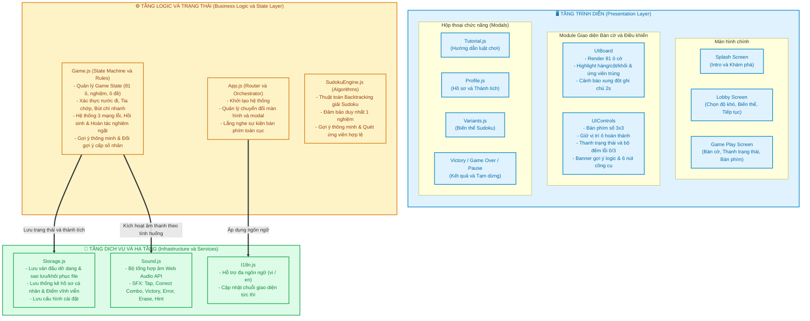

# 🏛️ Sơ đồ 01: Kiến trúc phân tầng module (Component Architecture)

Tài liệu này mô tả chi tiết kiến trúc 3 tầng (**3-Tier Architecture**) của game Sudoku, danh sách các module theo chuẩn **Module Pattern (IIFE)**, trách nhiệm và mối quan hệ phụ thuộc giữa chúng.

---

## 🏗️ 1. Sơ đồ phân tầng tổng thể

---

## 📋 2. Trách nhiệm chi tiết của từng module

| Module | File nguồn | Trách nhiệm chính | Public API tiêu biểu |
|:---|:---|:---|:---|
| **App** | `js/app.js` | Điều phối toàn cục, quản lý navigation màn hình (`splash`, `lobby`, `gameplay`), quản lý đóng/mở modal, thiết lập theme Sáng/Tối. | `init()`, `showToast(msg)`, `applyLanguage()` |
| **Game** | `js/game.js` | "Single Source of Truth": Quản lý toàn bộ dữ liệu ván đấu, xác nhận nước đi, ngăn điền thừa khi đủ 9 số, xử lý chế độ Tia chớp, tính điểm combo, giới hạn 3 mạng lỗi và cơ chế Hồi sinh bù điểm, đổi gợi ý bằng Điểm Hồ Sơ. | `start()`, `resume()`, `selectCell()`, `placeNumber()`, `toggleFastFill()`, `undo()`, `erase()`, `useHint()`, `buyExtraHint()`, `revive()` |
| **SudokuEngine** | `js/sudoku-engine.js` | Thuật toán sinh bàn cờ giải hoàn chỉnh bằng Backtracking ngẫu nhiên, thuật toán đục lỗ tạo đề bài đảm bảo duy nhất 1 nghiệm, kiểm tra tính hợp lệ của số. | `generate()`, `solve()`, `countSolutions()`, `isValid()` |
| **UIBoard** | `js/ui-board.js` | Khởi tạo DOM 81 ô cờ, render giá trị, ghi chú, áp dụng màu sắc công thái học (số đề in đậm 600 màu đen, số điền in thường 500 màu xanh, highlight hàng/cột/khối và cùng số). | `init()`, `render(state)`, `destroy()` |
| **UIControls** | `js/ui-controls.js` | Điều khiển bàn phím số 3x3 (giữ nguyên vị trí cố định của phím khi số đã hoàn thành), hiển thị đồng hồ bấm giờ, điểm số, badge chuỗi đúng, hiển thị lỗi 0/3. | `init()`, `update(state)` |
| **Storage** | `js/storage.js` | Quản trị lưu trữ `localStorage`, lưu ván chơi dở dang, sao lưu/khôi phục file JSON, quản lý điểm vĩnh viễn (Mastery Points), cài đặt người dùng. | `saveGame()`, `loadGame()`, `clearGame()`, `exportData()`, `importData()`, `getTotalPermanentScore()`, `deductPermanentScore()` |
| **Sound** | `js/sound.js` | Phát âm thanh sinh động trực tiếp từ Web Audio API (không cần tải file audio bên ngoài), âm thanh tap, combo nốt nhạc tăng dần, lỗi, xóa, gợi ý, nhạc thắng cuộc. | `playTap()`, `playCorrect(streak)`, `playError()`, `playErase()`, `playHint()`, `playWin()` |
| **I18n** | `js/i18n.js` | Từ điển đa ngôn ngữ (Tiếng Việt & English), tự động cập nhật toàn bộ nhãn giao diện khi người dùng chuyển đổi ngôn ngữ. | `t(key)`, `getLanguage()`, `setLanguage(lang)` |
