# 🏛️ Sơ Đồ 01: Kiến Trúc Phân Tầng Module (Component Architecture)

Tài liệu này mô tả chi tiết kiến trúc 3 tầng (**3-Tier Architecture**) của game Sudoku, danh sách các module theo chuẩn **Module Pattern (IIFE)**, trách nhiệm và mối quan hệ phụ thuộc giữa chúng.

---

## 🏗️ 1. Sơ Đồ Phân Tầng Tổng Thể

```mermaid
flowchart TD
    classDef presLayer fill:#E0F2FE,stroke:#0284C7,stroke-width:2px,color:#0369A1;
    classDef logicLayer fill:#FEF3C7,stroke:#D97706,stroke-width:2px,color:#92400E;
    classDef infraLayer fill:#DCFCE7,stroke:#16A34A,stroke-width:2px,color:#15803D;
    classDef devLayer fill:#FEE2E2,stroke:#DC2626,stroke-width:2px,color:#991B1B;

    subgraph L1 ["🖥️ TẦNG TRÌNH DIỄN (Presentation Layer)"]
        direction TB
        subgraph L1_Screens ["Màn hình chính"]
            SCR_SPLASH["Splash Screen<br/>(Intro và Khám phá)"]
            SCR_LOBBY["Lobby Screen<br/>(Chọn độ khó, Biến thể, Tiếp tục)"]
            SCR_GAME["Game Play Screen<br/>(Bàn cờ, Thanh trạng thái, Bàn phím)"]
        end
        subgraph L1_UI ["Module Giao diện Bàn cờ và Điều khiển"]
            UI_BOARD["UIBoard<br/>- Render 81 ô cờ<br/>- Highlight hàng/cột/khối<br/>- Phân biệt số đề/số điền"]
            UI_CTRL["UIControls<br/>- Bàn phím số 3x3<br/>- Giữ vị trí ô hoàn thành<br/>- Banner và Overlay nguy hiểm<br/>- Nút Undo, Erase, Tia chớp, Ghi chú"]
        end
        subgraph L1_Modals ["Hộp thoại chức năng (Modals)"]
            MOD_TUT["Tutorial.js<br/>(Hướng dẫn luật chơi)"]
            MOD_PROF["Profile.js<br/>(Hồ sơ và Thành tích)"]
            MOD_VAR["Variants.js<br/>(Biến thể Sudoku)"]
            MOD_RES["Victory / Game Over / Pause<br/>(Kết quả và Tạm dừng)"]
        end
    end
    class L1,SCR_SPLASH,SCR_LOBBY,SCR_GAME,UI_BOARD,UI_CTRL,MOD_TUT,MOD_PROF,MOD_VAR,MOD_RES presLayer;

    subgraph L2 ["⚙️ TẦNG LOGIC VÀ TRẠNG THÁI (Business Logic và State Layer)"]
        direction TB
        APP_CORE["App.js (Router và Orchestrator)<br/>- Khởi tạo hệ thống<br/>- Quản lý chuyển đổi màn hình và modal<br/>- Lắng nghe sự kiện bàn phím toàn cục"]
        GAME_CORE["Game.js (State Machine và Rules)<br/>- Quản lý Game State (81 ô, nghiệm, ô đề)<br/>- Xác thực nước đi và chế độ Tia chớp<br/>- Bộ tính điểm combo/streak/thời gian<br/>- Quản lý cảnh báo nguy hiểm 3 cấp và Undo Stack"]
        ENGINE["SudokuEngine.js (Algorithms)<br/>- Thuật toán Backtracking giải Sudoku<br/>- Kiểm tra tính duy nhất nghiệm (Unique Solution)<br/>- Thuật toán sinh đề theo độ khó"]
    end
    class L2,APP_CORE,GAME_CORE,ENGINE logicLayer;

    subgraph L3 ["💾 TẦNG DỊCH VỤ VÀ HẠ TẦNG (Infrastructure và Services)"]
        direction TB
        STORAGE["Storage.js<br/>- Lưu ván đấu dở dang<br/>- Lưu thống kê hồ sơ cá nhân<br/>- Lưu cấu hình cài đặt"]
        SOUND["Sound.js<br/>- Bộ tổng hợp âm Web Audio API<br/>- SFX: Tap, Correct Combo, Victory, Danger Heartbeat"]
        I18N["I18n.js<br/>- Hỗ trợ đa ngôn ngữ (vi / en)<br/>- Cập nhật chuỗi giao diện tức thì"]
    end
    class L3,STORAGE,SOUND,I18N infraLayer;

    subgraph L4 ["🛠️ CÔNG CỤ PHÁT TRIỂN VÀ TEST (Developer và QA Tools)"]
        DEVTOOLS["DevTools.js và CSS<br/>- Bảng điều khiển HUD nổi<br/>- Hiện đáp án mờ (Ghost Mode)<br/>- Vô hạn gợi ý, Thắng tức thì, Test cấp nguy hiểm"]
    end
    class L4,DEVTOOLS devLayer;

    %% Luồng liên kết phân tầng
    SCR_SPLASH --> APP_CORE
    SCR_LOBBY --> APP_CORE
    APP_CORE ==>|"Khởi tạo và Điều phối"| GAME_CORE
    GAME_CORE ==>|"Sinh và kiểm tra đề bài"| ENGINE

    GAME_CORE -->|"_notify(state)"| UI_BOARD
    GAME_CORE -->|"_notify(state)"| UI_CTRL
    UI_CTRL -->|"Gọi hàm hành động (place, select, undo)"| GAME_CORE
    UI_BOARD -->|"Gọi selectCell(r, c)"| GAME_CORE

    APP_CORE -.-> MOD_TUT
    APP_CORE -.-> MOD_PROF
    APP_CORE -.-> MOD_VAR

    GAME_CORE ==>|"Lưu trạng thái và thành tích"| STORAGE
    GAME_CORE ==>|"Kích hoạt âm thanh theo tình huống"| SOUND
    APP_CORE ==>|"Áp dụng ngôn ngữ"| I18N

    DEVTOOLS -. "Can thiệp và giám sát trạng thái" .-> GAME_CORE
    DEVTOOLS -. "Hook vào hàm render bàn cờ" .-> UI_BOARD
```

---

## 📋 2. Trách Nhiệm Chi Tiết Của Từng Module

| Module | File nguồn | Trách nhiệm chính | Public API tiêu biểu |
|:---|:---|:---|:---|
| **App** | `js/app.js` | Điều phối toàn cục, quản lý navigation màn hình (`splash`, `lobby`, `gameplay`), quản lý đóng/mở modal, thiết lập theme Sáng/Tối. | `init()`, `showToast(msg)`, `applyLanguage()` |
| **Game** | `js/game.js` | "Single Source of Truth": Quản lý toàn bộ dữ liệu ván đấu, xác nhận nước đi, ngăn điền thừa khi đủ 9 số, xử lý chế độ Tia chớp, tính toán điểm số và cấp độ nguy hiểm. | `newGame()`, `selectCell()`, `placeNumber()`, `toggleFastFill()`, `undo()`, `erase()`, `useHint()`, `getState()` |
| **SudokuEngine** | `js/sudoku-engine.js` | Thuật toán sinh bàn cờ giải hoàn chỉnh bằng Backtracking ngẫu nhiên, thuật toán đục lỗ tạo đề bài đảm bảo duy nhất 1 nghiệm, kiểm tra tính hợp lệ của số. | `generate()`, `solve()`, `countSolutions()`, `isValid()` |
| **UIBoard** | `js/ui-board.js` | Khởi tạo DOM 81 ô cờ, render giá trị, ghi chú, áp dụng màu sắc công thái học (số đề in đậm 600 màu đen, số điền in thường 500 màu xanh, highlight hàng/cột/khối và cùng số). | `init()`, `render(state)`, `destroy()` |
| **UIControls** | `js/ui-controls.js` | Điều khiển bàn phím số 3x3 (giữ nguyên vị trí cố định của phím khi số đã hoàn thành), hiển thị đồng hồ bấm giờ, điểm số, badge chuỗi thắng, banner cảnh báo lỗi 3 cấp. | `init()`, `update(state)` |
| **Storage** | `js/storage.js` | Quản trị lưu trữ `localStorage`, lưu ván chơi đang dở, thành tích theo từng độ khó, cài đặt người dùng, chống hỏng dữ liệu khi tải lại trang. | `saveGame()`, `loadGame()`, `clearGame()`, `getProfile()`, `getSettings()` |
| **Sound** | `js/sound.js` | Phát âm thanh sinh động trực tiếp từ Web Audio API (không cần tải file audio bên ngoài), âm thanh tap, combo nốt nhạc tăng dần, nhịp tim nguy hiểm, nhạc thắng cuộc. | `playTap()`, `playCorrect(streak)`, `playError()`, `playDanger()`, `playWin()` |
| **I18n** | `js/i18n.js` | Từ điển đa ngôn ngữ (Tiếng Việt & English), tự động cập nhật toàn bộ nhãn giao diện khi người dùng chuyển đổi ngôn ngữ. | `t(key)`, `getLanguage()`, `setLanguage(lang)` |
| **DevTools** | `devtools/devtools.js` | Bộ công cụ kiểm thử dành riêng cho nhà phát triển và QA: Ghost Answers, vô hạn gợi ý, thắng nhanh, mô phỏng các chuỗi sai nguy hiểm. | `init()`, `isGhostActive()` |
