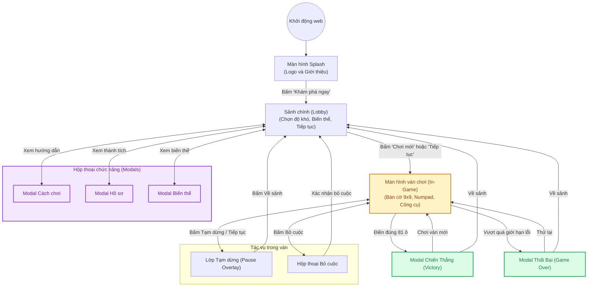
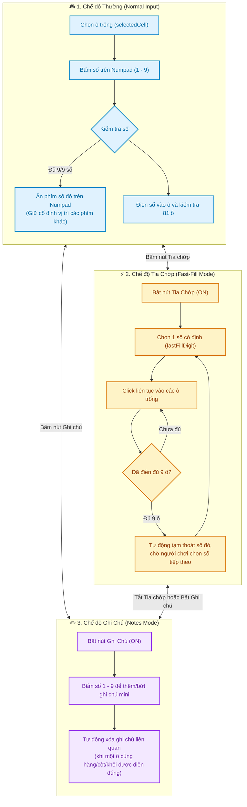
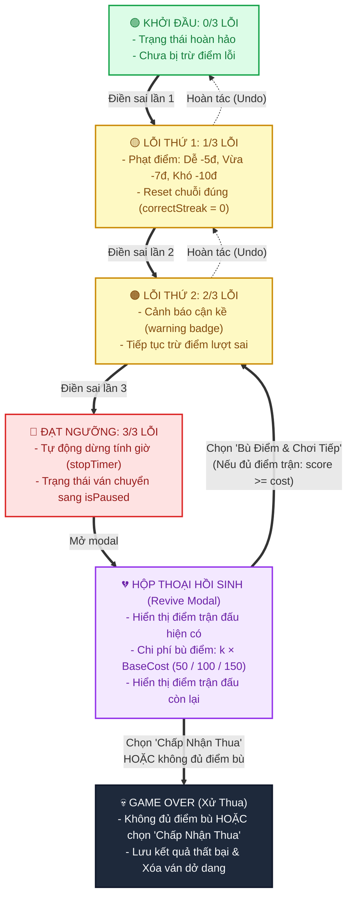

# 🔄 Sơ đồ 02: Vòng đời & máy trạng thái (Game State Lifecycle)

Tài liệu này mô hình hóa toàn bộ vòng đời chuyển trạng thái của người chơi, bao gồm:
1. **Luồng điều hướng màn hình (Screen Navigation Flow)**
2. **Máy trạng thái trong ván chơi (In-Game Modes & Interactions)**
3. **Cơ chế giới hạn 3 mạng lỗi sai & Hồi sinh bù điểm (3-Mistake Limit & Revive Lifecycle)**

---

## 🧭 1. Luồng điều hướng màn hình (Screen Navigation Flow)

---

## ⚡ 2. Máy trạng thái trong ván chơi (In-Game Modes)

Trong lúc chơi, người dùng có thể linh hoạt chuyển đổi qua lại giữa **Chế độ Thường (Normal Mode)**, **Chế độ Tia chớp (Fast-Fill Mode)** và **Chế độ Ghi chú (Notes Mode)**.

---

## 💔 3. Cơ chế giới hạn 3 lỗi sai & hồi sinh bù điểm (3-Mistake Limit & Revive Lifecycle)

Trong Sudoku tiêu chuẩn, người chơi được cung cấp tối đa **3 cơ hội sai** (`0/3` $\rightarrow$ `3/3`). Mỗi lần phạm lỗi sẽ bị trừ điểm theo độ khó (Dễ: -5đ, Trung bình: -7đ, Khó: -10đ, điểm số không âm). Khi đạt ngưỡng `3/3`, trận đấu tự động tạm dừng và mở Hộp thoại Hồi sinh.

### 📋 Bảng phạt lỗi & chi phí hồi sinh từng độ khó:

| Độ khó | Điểm trừ mỗi lỗi sai | Chi phí Hồi sinh lần 1 ($1\times$) | Chi phí Hồi sinh lần 2 ($2\times$) | Chi phí Hồi sinh lần $k$ ($k\times$) | Trạng thái sau Hồi sinh |
|:---|:---:|:---:|:---:|:---:|:---:|
| **Dễ (Easy)** | -5 điểm | 50 điểm | 100 điểm | $k \times 50$ điểm | Lỗi giảm về **2/3**, xóa ô số vừa điền sai |
| **Trung bình (Medium)** | -7 điểm | 100 điểm | 200 điểm | $k \times 100$ điểm | Lỗi giảm về **2/3**, xóa ô số vừa điền sai |
| **Khó (Hard)** | -10 điểm | 150 điểm | 300 điểm | $k \times 150$ điểm | Lỗi giảm về **2/3**, xóa ô số vừa điền sai |
