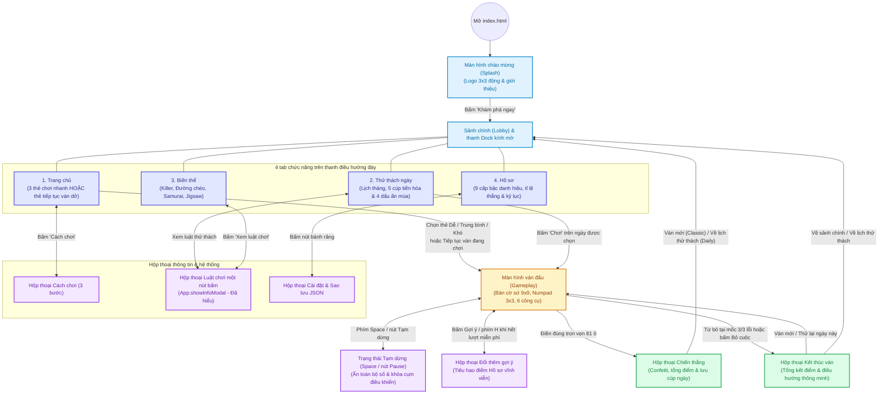
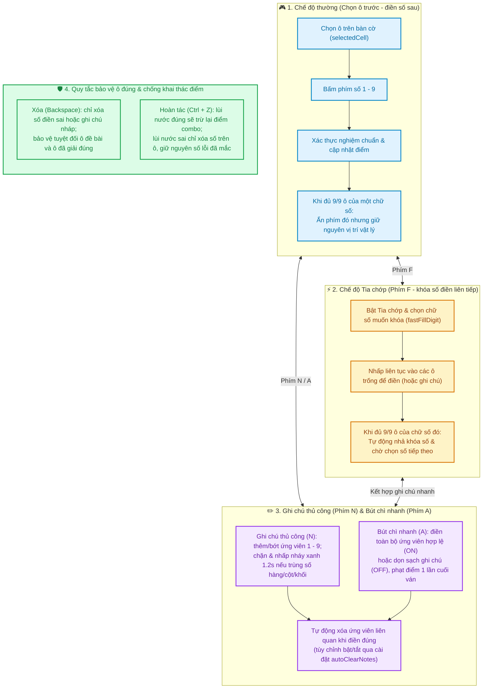
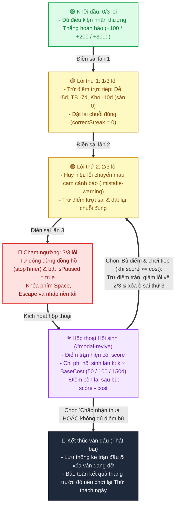

# 🔄 Sơ đồ 02: Vòng đời & máy trạng thái (Game state lifecycle)

Tài liệu này mô hình hóa vòng đời chuyển đổi trạng thái trong toàn bộ ứng dụng, bao gồm:
1. **Luồng điều hướng màn hình & 4 tab sảnh chính**
2. **Máy trạng thái chế độ nhập liệu & công cụ trong ván đấu**
3. **Cơ chế giới hạn 3 mạng lỗi sai, Hồi sinh bù điểm & Đổi gợi ý**

---

## 🧭 1. Luồng điều hướng màn hình & 4 tab sảnh chính

---

## ⚡ 2. Máy trạng thái chế độ nhập liệu trong ván đấu

Trong quá trình giải đố, người chơi chuyển đổi tức thì giữa **Chế độ thường**, **Chế độ Tia chớp (`F`)**, **Ghi chú thủ công (`N`)** và **Bút chì nhanh (`A`)**, kết hợp quy tắc bảo vệ ô đúng khi **Xóa (`Backspace`)** và khấu trừ điểm công bằng khi **Hoàn tác (`Ctrl + Z`)**.

---

## 💔 3. Vòng đời 3 mạng lỗi sai & cơ chế Hồi sinh bù điểm

Mỗi ván đấu có giới hạn tối đa **3 lỗi sai** (`0/3` đến `3/3`). Khi chạm mốc `3/3`, bộ đếm giờ dừng lại, các phím tắt tạm dừng (`Space`, `Escape`) và thao tác nhấp ra ngoài nền tối đều bị khóa bảo vệ để người chơi đưa ra quyết định rõ ràng trên **Hộp thoại Hồi sinh**.

### 📋 Bảng phạt lỗi, chi phí Hồi sinh & chi phí Đổi thêm gợi ý

| Độ khó | Phạt mỗi lỗi sai | Hồi sinh lần $k$ (trừ điểm trận) | Đổi gợi ý thêm lần $k$ (trừ điểm Hồ sơ) | Trạng thái sau Hồi sinh |
|:---|:---:|:---:|:---:|:---|
| **Dễ (Easy)** | -5 điểm | $k \times 50$ điểm (50, 100, 150...) | $50 \times 2^{k-1}$ điểm (50, 100, 200...) | Lỗi giảm về **2/3**, xóa ô số vừa sai |
| **Trung bình (Medium)** | -7 điểm | $k \times 100$ điểm (100, 200, 300...) | $100 \times 2^{k-1}$ điểm (100, 200, 400...) | Lỗi giảm về **2/3**, xóa ô số vừa sai |
| **Khó (Hard)** | -10 điểm | $k \times 150$ điểm (150, 300, 450...) | $150 \times 2^{k-1}$ điểm (150, 300, 600...) | Lỗi giảm về **2/3**, xóa ô số vừa sai |
