# 🔄 Sơ Đồ 02: Vòng Đời & Máy Trạng Thái (Game State Lifecycle)

Tài liệu này mô hình hóa toàn bộ vòng đời chuyển trạng thái của người chơi, bao gồm:
1. **Luồng điều hướng màn hình (Screen Navigation Flow)**
2. **Máy trạng thái trong ván chơi (In-Game Modes & Interactions)**
3. **Cơ chế leo thang cảnh báo lỗi 3 cấp (Danger & Mistake Escalation Lifecycle)**

---

## 🧭 1. Luồng Điều Hướng Màn Hình (Screen Navigation)

```mermaid
stateDiagram-v2
    [*] --> Splash_Screen : Khởi động trang web

    state Splash_Screen {
        [*] --> Intro_Display : Hiển thị Logo & Giới thiệu
        Intro_Display --> Lobby_Screen : Bấm "Khám phá ngay"
    }

    state Lobby_Screen {
        [*] --> Menu_Main : Sảnh chính
        Menu_Main --> Modal_Tutorial : Bấm "Cách chơi"
        Menu_Main --> Modal_Profile : Bấm "Hồ sơ"
        Menu_Main --> Modal_Variants : Bấm "Biến thể"
        
        Modal_Tutorial --> Menu_Main : Đóng
        Modal_Profile --> Menu_Main : Đóng
        Modal_Variants --> Menu_Main : Đóng

        Menu_Main --> InGame_Playing : Bấm "Chơi mới" (Chọn độ khó)
        Menu_Main --> InGame_Playing : Bấm "Tiếp tục" (Có ván lưu)
    }

    state InGame_Playing {
        [*] --> Active_Board
        Active_Board --> Pause_Overlay : Bấm "Tạm dừng"
        Pause_Overlay --> Active_Board : Bấm "Tiếp tục"
        Pause_Overlay --> Lobby_Screen : Bấm "Về sảnh" (Lưu ván)
        
        Active_Board --> Modal_Confirm_Abandon : Bấm "Bỏ cuộc"
        Modal_Confirm_Abandon --> Active_Board : Hủy
        Modal_Confirm_Abandon --> Lobby_Screen : Xác nhận bỏ cuộc
    }

    InGame_Playing --> Victory_Modal : Hoàn thành chính xác 81 ô
    InGame_Playing --> GameOver_Modal : Vượt quá giới hạn lỗi / Chuỗi sai

    Victory_Modal --> InGame_Playing : Ván chơi mới
    Victory_Modal --> Lobby_Screen : Về sảnh chính

    GameOver_Modal --> InGame_Playing : Thử lại
    GameOver_Modal --> Lobby_Screen : Về sảnh chính
```

---

## ⚡ 2. Máy Trạng Thái Trong Ván Chơi (In-Game Modes)

Trong lúc chơi, người dùng có thể linh hoạt chuyển đổi giữa **Chế độ Thường (Normal Mode)**, **Chế độ Tia chớp (Fast-Fill Mode)** và **Chế độ Ghi chú (Notes Mode)**.


---

## 🚨 3. Cơ Chế Leo Thang Cảnh Báo Lỗi 3 Cấp (Danger Escalation)

Hệ thống tính toán nguy hiểm dựa trên hai tiêu chí: **Tổng số lỗi lũy kế** (`mistakes`) và **Chuỗi sai liên tiếp** (`wrongStreak`).

```mermaid
flowchart LR
    classDef safe fill:#DCFCE7,stroke:#16A34A,stroke-width:2px,color:#15803D;
    classDef stage1 fill:#FEF9C3,stroke:#CA8A04,stroke-width:2px,color:#854D0E;
    classDef stage2 fill:#FFEDD5,stroke:#EA580C,stroke-width:2px,color:#9A3412;
    classDef stage3 fill:#FEE2E2,stroke:#DC2626,stroke-width:2px,color:#991B1B;
    classDef finish fill:#1E293B,stroke:#0F172A,stroke-width:2px,color:#F8FAFC;

    ST_SAFE["🟢 CẤP 0: AN TOÀN<br/>- Không có lỗi vi phạm<br/>- Giao diện bình thường<br/>- Không trừ điểm bổ sung"]
    
    ST_MILD["🟡 CẤP 1: NHẮC NHỞ<br/>- Bắt đầu có lỗi (1-4 lỗi)<br/>- Chớp viền nhẹ màn hình<br/>- Thông báo trừ điểm cơ bản"]
    
    ST_WARN["🟠 CẤP 2: NGUY HIỂM NHẸ<br/>- Sai 5-9 lỗi HOẶC chuỗi sai 2 lượt<br/>- Banner cảnh báo màu cam<br/>- Nhịp tim cảnh báo phát ra"]
    
    ST_CRIT["🔴 CẤP 3: NGUY HIỂM CẤP BÁO<br/>- Đạt ngưỡng sát giới hạn thua<br/>(Dễ/Vừa: 10-15 lỗi, Khó: 10 lỗi)<br/>- Chuỗi sai sát nút (2/3 hoặc 4/5)<br/>- Màn hình thở đỏ rực + Còi báo động"]

    ST_DEAD["💀 GAME OVER<br/>- Vượt quá tổng lỗi cho phép<br/>HOẶC vượt chuỗi sai tối đa<br/>- Dừng tính giờ & Lưu thất bại"]

    ST_SAFE ==>|"Phạm lỗi đầu tiên"| ST_MILD
    ST_MILD ==>|"Tiếp tục sai"| ST_WARN
    ST_WARN ==>|"Tiếp tục sai hoặc chuỗi sai dài"| ST_CRIT
    ST_CRIT ==>|"Sai thêm 1 lần nữa"| ST_DEAD

    ST_WARN -.->|"Điền ĐÚNG 1 số<br/>(Khử chuỗi sai về 0)"| ST_MILD
    ST_CRIT -.->|"Điền ĐÚNG 1 số<br/>(Khử chuỗi sai về 0)"| ST_WARN
    ST_MILD -.->|"Undo lượt sai"| ST_SAFE

    class ST_SAFE safe;
    class ST_MILD stage1;
    class ST_WARN stage2;
    class ST_CRIT stage3;
    class ST_DEAD finish;
```



