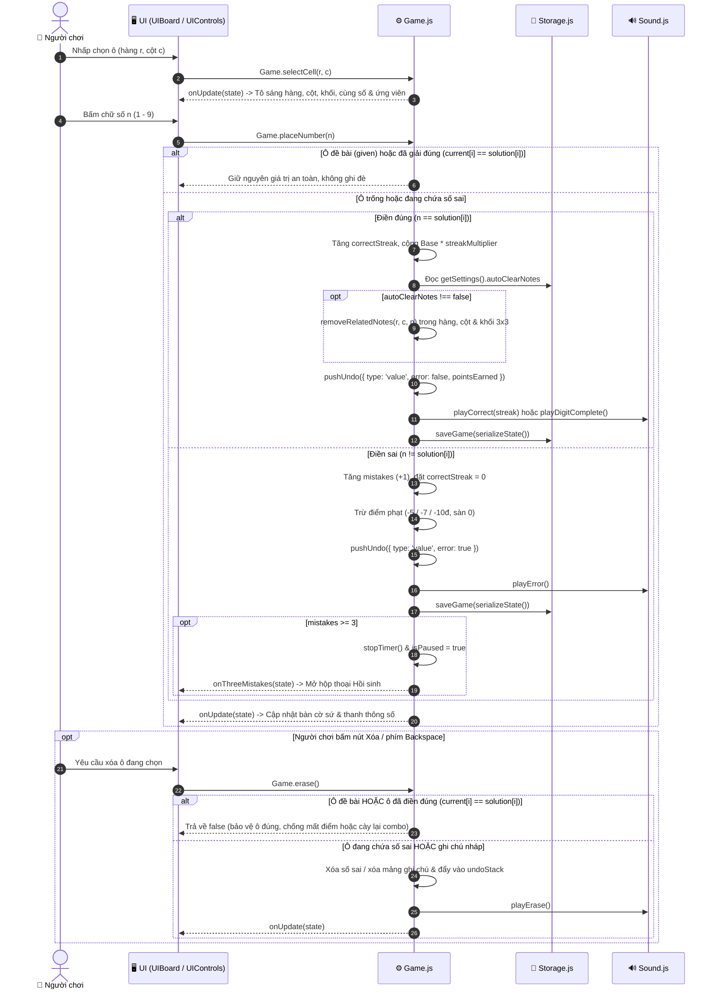
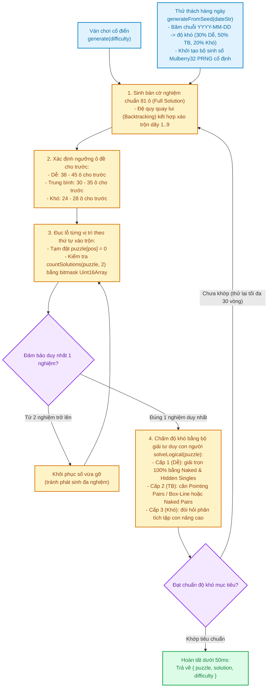

# ⚡ Sơ đồ 03: Luồng dữ liệu & trình tự tương tác (Data flow & sequences)

Tài liệu này mô hình hóa trình tự tương tác thời gian thực (**Sequence Diagrams**) và đường ống thuật toán cho các nghiệp vụ cốt lõi của trò chơi.

---

## 🔢 1. Trình tự điền số, xóa an toàn & kiểm tra kết quả

Quy trình tuần tự khi người chơi chọn ô, điền chữ số, tự động dọn ghi chú theo cài đặt `autoClearNotes`, xử lý lỗi sai hoặc bảo vệ ô đã giải đúng khi bấm `Xóa`:



---

## ⚡ 2. Vòng lặp chế độ Tia chớp (Lightning / Fast-Fill mode)

Quy trình người chơi bật chế độ Tia chớp (`F`), khóa một chữ số và nhấp liên tục lên các ô trống cho tới khi hoàn tất trọn vẹn 9 ô của chữ số đó:

```mermaid
sequenceDiagram
    autonumber
    actor Player as 👤 Người chơi
    participant UI as 🖥️ UIControls / UIBoard
    participant Game as ⚙️ Game.js
    participant Sound as 🔊 Sound.js

    Player->>UI: Bấm nút "Tia chớp" hoặc phím F
    UI->>Game: Game.toggleFastFill()
    Game->>Game: state.fastFillMode = true
    Game-->>UI: Bật huy hiệu Tia chớp = "ON"

    Player->>UI: Chọn chữ số n trên Numpad (hoặc nhấp ô đã có số n trên bàn cờ)
    UI->>Game: Game.selectFastFillDigit(n) / selectCell(r, c)
    Game->>Game: state.fastFillDigit = n
    Game-->>UI: Viền sáng phím số n (.locked-digit), làm dịu nhẹ các phím khác (.dimmed),<br/>tô sáng toàn bộ ứng viên ghi chú số n trên bàn cờ (.note-highlighted)

    loop Điền liên tiếp các ô trống
        Player->>UI: Nhấp vào một ô trống (r, c)
        UI->>Game: Game.selectCell(r, c) -> tự động gọi _placeValue / _placeNote
        Game->>Game: Kiểm tra số lượng còn lại getRemaining(n)

        alt Còn ô chưa điền (Remaining > 0)
            Game-->>UI: Duy trì khóa số n để nhấp ô tiếp theo ngay lập tức
        else Đã hoàn thành đủ 9/9 ô (Remaining == 0)
            Game->>Game: Đặt fastFillDigit = null & selectedCell = null
            Game->>Sound: Sound.playDigitComplete()
            Game-->>UI: Ẩn phím số n (visibility: hidden; opacity: 0)<br/>nhưng giữ nguyên ô lưới vật lý cho 8 phím còn lại
        end
    end
```

---

## 🧮 3. Đường ống sinh đề duy nhất nghiệm & Thử thách ngày (SudokuEngine pipeline)

Module `SudokuEngine` hỗ trợ đồng thời hai luồng khởi tạo câu đố: **ngẫu nhiên thời gian thực** cho ván cổ điển (`generate`) và **tất định theo hạt giống ngày** bằng bộ sinh số giả ngẫu nhiên **Mulberry32 PRNG** cho sảnh Thử thách ngày (`generateFromSeed`):


