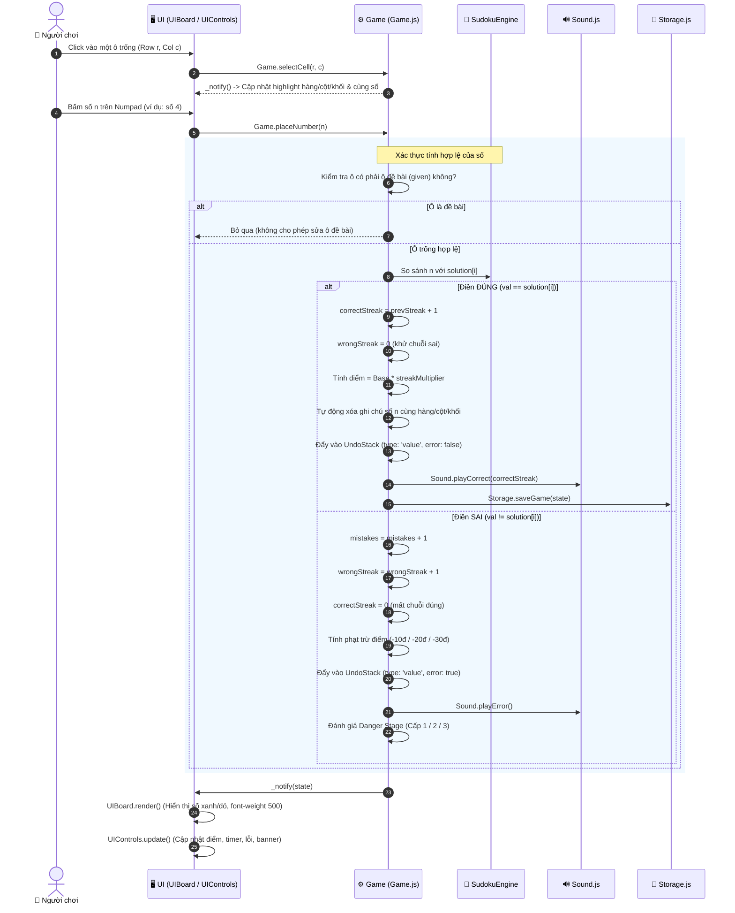
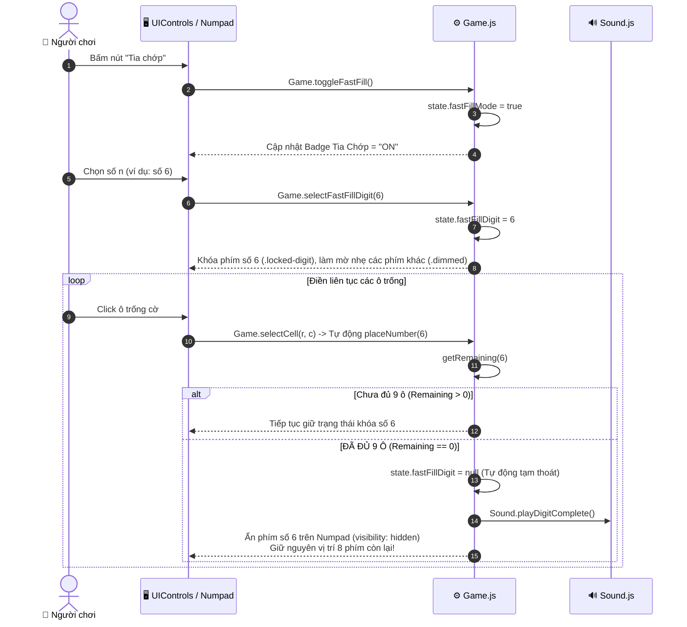
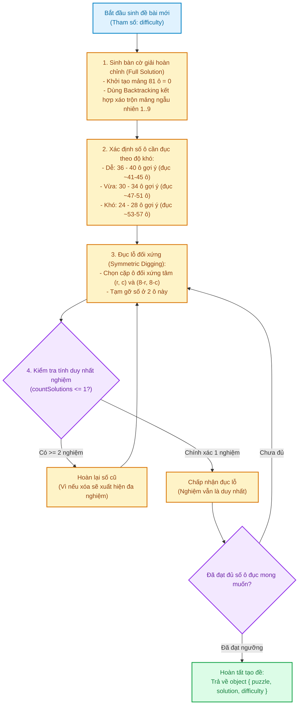

# ⚡ Sơ Đồ 03: Luồng Dữ Liệu & Trình Tự Tương Tác (Data Flow & Sequences)

Tài liệu này mô hình hóa chi tiết các luồng dữ liệu tương tác theo thời gian thực (Sequence Diagrams) cho 3 tác vụ quan trọng nhất của trò chơi.

---

## 🔢 1. Trình Tự Điền Số & Kiểm Tra Kết Quả (Cell Placement Flow)

Quy trình tuần tự từ lúc người chơi chọn ô, bấm số trên bàn phím, kiểm tra tính đúng/sai, cộng điểm streak, phát âm thanh và lưu trạng thái:

---

## ⚡ 2. Vòng Lặp Chế Độ Tia Chớp (Lightning / Fast-Fill Mode Loop)

Quy trình người chơi kích hoạt chế độ Tia chớp, ghim 1 số và điền liên tục cho đến khi hoàn tất đủ 9 ô:

---

## 🧮 3. Thuật Toán Sinh Đề Duy Nhất Nghiệm (Sudoku Engine Pipeline)

Thuật toán sinh bàn cờ giải hoàn chỉnh và đục lỗ đảm bảo **duy nhất 1 nghiệm (Unique Solution)**:

