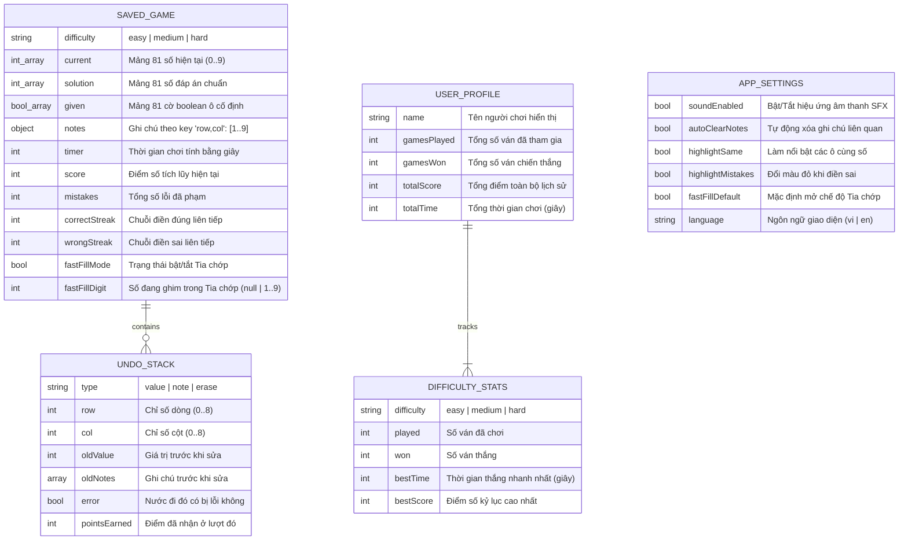
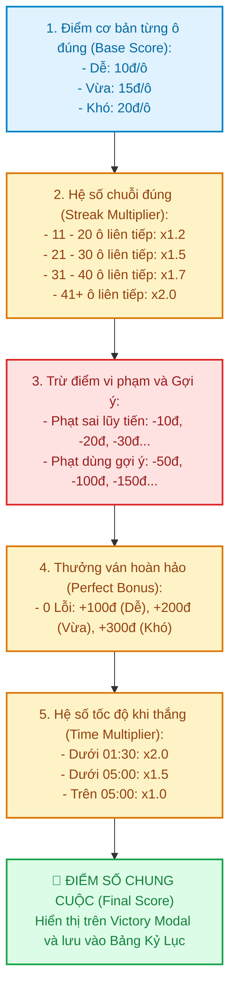
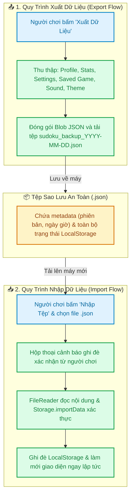

# 💾 Sơ Đồ 04: Mô Hình Dữ Liệu & Hệ Thống Chấm Điểm (Storage & Scoring)

Tài liệu này mô hình hóa cấu trúc dữ liệu lưu trữ bền vững trong `localStorage` và đường ống giải thuật tính toán điểm số (**Scoring Pipeline**).

---

## 🗄️ 1. Cấu Trúc Dữ Liệu Lưu Trữ (LocalStorage Schema)

Hệ thống sử dụng các khóa độc lập trong `localStorage` để phân tách rõ ràng giữa trạng thái ván chơi, hồ sơ thành tích và tùy chọn cài đặt:

---

## 🏆 2. Đường Ống Tính Toán Điểm Số (Scoring Pipeline)

Điểm số cuối cùng của ván chơi được tổng hợp qua công thức:

$$\text{Final Score} = \Big(\sum \text{Base Points} \times \text{Streak Mult} - \text{Mistake Penalties} - \text{Hint Penalties} + \text{Perfect Bonus}\Big) \times \text{Time Mult}$$

---

## 🔄 3. Cơ Chế Sao Lưu & Chuyển Đổi Tiến Trình Trò Chơi (Backup & Cross-Device Transfer)

Để hỗ trợ người chơi chuyển đổi giữa các thiết bị máy tính hoặc trình duyệt khác nhau mà không làm mất hàng trăm trận đấu và kỷ lục (do trò chơi vận hành phía client tĩnh trên GitHub Pages), hệ thống cung cấp tính năng **Xuất (Export)** và **Nhập (Import)** dữ liệu an toàn dưới chuẩn JSON:

