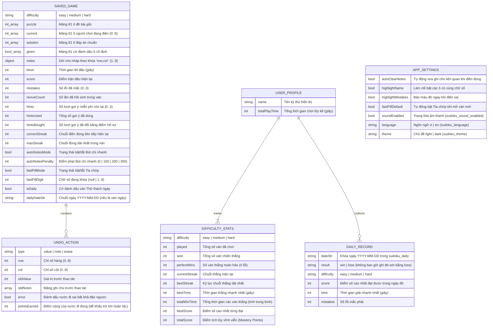
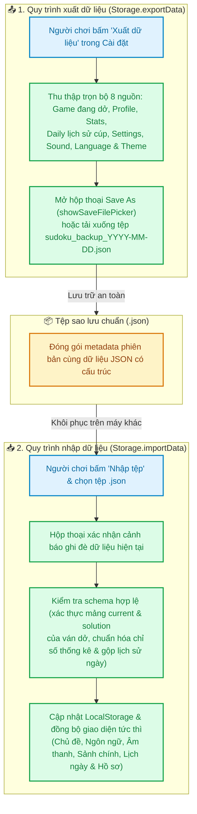

# 💾 Sơ đồ 04: Mô hình dữ liệu & hệ thống tính điểm (Storage & scoring)

Tài liệu này mô hình hóa cấu trúc **8 khóa dữ liệu bền vững** trong `localStorage`, đường ống tính toán điểm số (**Scoring Pipeline**) và cơ chế sao lưu / khôi phục tệp JSON giữa các thiết bị.

---

## 🗄️ 1. Cấu trúc dữ liệu lưu trữ (LocalStorage schema)

Module `Storage` phân tách rạch ròi trạng thái ván đang chơi, hồ sơ cá nhân, thống kê 3 độ khó, lịch sử Thử thách ngày trọn đời và các tùy chọn cài đặt:

---

## 🏆 2. Đường ống tính toán điểm số (Scoring pipeline)

Điểm số chung cuộc của mỗi ván đấu được tổng hợp chính xác qua công thức:

$$\text{Final Score} = \text{round}\Big(\max\big(0,\; \text{InMatchScore} - \text{AutoNotesPenalty}\big) \times \text{TimeMultiplier}\Big)$$

Trong đó $\text{InMatchScore}$ là điểm số trực tiếp trong ván (đã cộng từng ô nhân hệ số chuỗi đúng, cộng thưởng hoàn hảo nếu 0 lỗi, trừ phạt lỗi sai, trừ phạt 3 gợi ý đầu và trừ chi phí bù điểm hồi sinh, luôn giữ sàn $\ge 0$).

```mermaid
flowchart TD
    classDef base fill:#E0F2FE,stroke:#0284C7,stroke-width:2px,color:#0369A1;
    classDef mult fill:#FEF3C7,stroke:#D97706,stroke-width:2px,color:#92400E;
    classDef penalty fill:#FEE2E2,stroke:#DC2626,stroke-width:2px,color:#991B1B;
    classDef total fill:#DCFCE7,stroke:#16A34A,stroke-width:2px,color:#15803D;

    P_BASE["1. Điểm cơ bản mỗi ô điền đúng:<br/>- Dễ: +10đ/ô | Trung bình: +20đ/ô | Khó: +40đ/ô"]

    P_STREAK["2. Nhân hệ số chuỗi đúng liên tiếp (Streak Multiplier):<br/>- Ô 1 - 10: ×1.0 | Ô 11 - 20: ×1.2 | Ô 21 - 30: ×1.5<br/>- Ô 31 - 40: ×1.7 | Ô 41 trở lên: ×2.0"]

    P_INMATCH_PEN["3. Khấu trừ trực tiếp trong ván (sàn tối thiểu 0đ):<br/>- Phạt nước sai: Dễ -5đ, TB -7đ, Khó -10đ<br/>- Phạt 3 gợi ý miễn phí: Dễ (30, 50, 70), TB (50, 70, 90), Khó (50, 100, 150)<br/>- Bù điểm Hồi sinh (khi chạm 3/3 lỗi): k × BaseCost (50 / 100 / 150đ)<br/>- Lưu ý: Đổi gợi ý từ lần 4 trừ vào điểm Hồ sơ vĩnh viễn (BaseCost × 2^(k-1))"]

    P_BONUS["4. Thưởng thắng hoàn hảo (khi giải xong 81 ô với 0 lỗi):<br/>- Dễ: +100đ | Trung bình: +200đ | Khó: +300đ"]

    P_AUTONOTES["5. Khấu trừ công cụ cuối ván:<br/>- Phạt Bút chì nhanh (nếu có bật trong ván, phạt 1 lần duy nhất):<br/>  Dễ -100đ | Trung bình -200đ | Khó -300đ"]

    P_TIME["6. Nhân hệ số tốc độ hoàn thành (Time Multiplier):<br/>- Dễ: <1p30s ×2.0, <5p ×1.5, >=5p ×1.0<br/>- Trung bình: <3p ×2.0, <10p ×1.5, >=10p ×1.0<br/>- Khó: <6p ×2.0, <20p ×1.5, >=20p ×1.0"]

    P_FINAL["🏁 Tổng điểm đạt được (Final Score)<br/>Cộng dồn vào điểm Hồ sơ vĩnh viễn (9 cấp bậc danh hiệu) & lưu kỷ lục"]

    P_BASE --> P_STREAK --> P_INMATCH_PEN --> P_BONUS --> P_AUTONOTES --> P_TIME --> P_FINAL

    class P_BASE base;
    class P_STREAK,P_BONUS,P_TIME mult;
    class P_INMATCH_PEN,P_AUTONOTES penalty;
    class P_FINAL total;
```

---

## 🔄 3. Cơ chế sao lưu & khôi phục tiến trình toàn diện (JSON backup & restore)

Nhằm giúp người chơi dễ dàng chuyển toàn bộ lịch sử thi đấu giữa nhiều máy tính mà không cần tài khoản trực tuyến, hệ thống hỗ trợ xuất và nhập gói dữ liệu `.json` an toàn:

