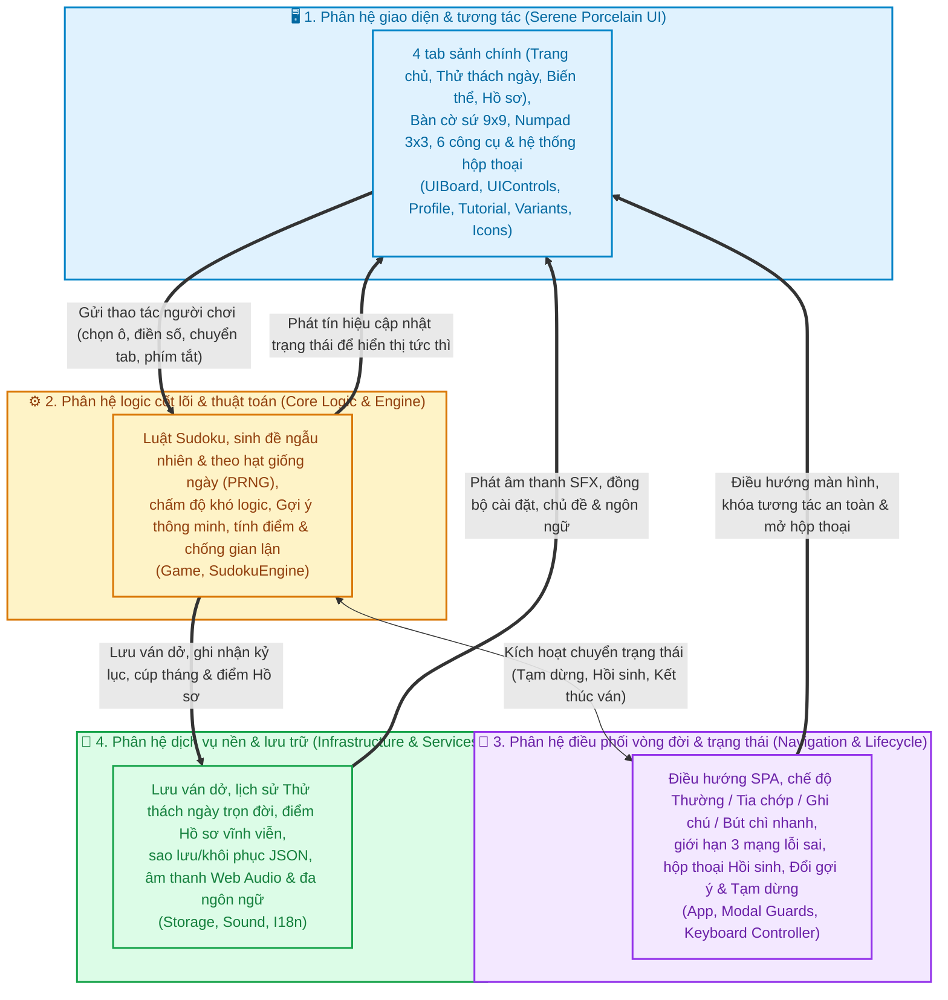

# 📐 Tài liệu kiến trúc & sơ đồ hệ thống (Sudoku Web)

Chào mừng bạn đến với tài liệu kiến trúc của dự án **Sudoku Web** (Pure Vanilla JavaScript).

Thư mục này cung cấp hệ thống sơ đồ trực quan chuẩn **Mermaid.js**, giúp các nhà phát triển và cộng tác viên nắm bắt nhanh bức tranh tổng thể cũng như luồng xử lý chi tiết bên trong trò chơi.

---

## 🗺️ 1. Sơ đồ tổng thể hệ thống (Master system map)

Sơ đồ dưới đây mô phỏng sự tương tác giữa **4 phân hệ cốt lõi** của ứng dụng. Bạn có thể mở từng tài liệu chuyên đề ở mục 2 để xem sơ đồ chi tiết của từng phân hệ.

---

## 📚 2. Danh mục các sơ đồ chuyên sâu

Toàn bộ kiến trúc nội bộ được phân tách mạch lạc thành 4 tài liệu chuyên đề:

| STT | Tài liệu chuyên sâu | Nội dung mô hình hóa | Liên kết |
|:---:|:---|:---|:---:|
| **01** | **Kiến trúc phân tầng 12 module** | Phân tầng Presentation, Business Logic và Infrastructure theo chuẩn Module Pattern (IIFE), trách nhiệm 12 module JS, 7 tệp CSS và danh mục API công khai. | [Xem sơ đồ 01](01_component_architecture.md) |
| **02** | **Vòng đời & máy trạng thái** | Luồng điều hướng 4 sảnh chính, hộp thoại thông tin một nút bấm, chuyển đổi chế độ chơi (Thường, Tia chớp, Ghi chú, Bút chì nhanh) và vòng đời 3 mạng lỗi / Hồi sinh. | [Xem sơ đồ 02](02_game_state_lifecycle.md) |
| **03** | **Luồng dữ liệu & trình tự tương tác** | Biểu đồ tuần tự khi điền số (kèm tự xóa ghi chú theo cài đặt), bảo vệ ô đúng khi Xóa, vòng lặp Tia chớp và thuật toán sinh đề ngẫu nhiên / theo ngày. | [Xem sơ đồ 03](03_data_flow_and_sequences.md) |
| **04** | **Mô hình dữ liệu & hệ thống tính điểm** | Cấu trúc 8 khóa LocalStorage (bao gồm lịch sử Thử thách ngày và điểm Hồ sơ), đường ống tính điểm cuối ván và quy trình sao lưu / khôi phục JSON. | [Xem sơ đồ 04](04_storage_and_scoring_models.md) |

---

## 🛠️ 3. Nguyên tắc thiết kế cốt lõi

1. **Pure Vanilla JS (Zero Dependencies):** Toàn bộ ứng dụng vận hành trực tiếp trên trình duyệt từ tệp `index.html` mà không cần công cụ đóng gói hay thư viện ngoài.
2. **Module Pattern & đóng gói độc lập:** Cả 12 tệp JavaScript đều được đóng gói trong closure IIFE riêng biệt, bảo vệ trạng thái nội bộ và giao tiếp qua API rõ ràng.
3. **Single Source of Truth:** Module `Game` giữ vai trò nguồn trạng thái duy nhất cho ván đấu đang diễn ra, đồng bộ ra `UIBoard` và `UIControls` thông qua cơ chế callback phản ứng.
4. **Lưu trữ bền vững & di động:** Tự động lưu sau mỗi nước đi vào `localStorage` kèm bộ nhớ đệm dự phòng và cơ chế xuất/nhập tệp `.json` đầy đủ giữa các thiết bị.
