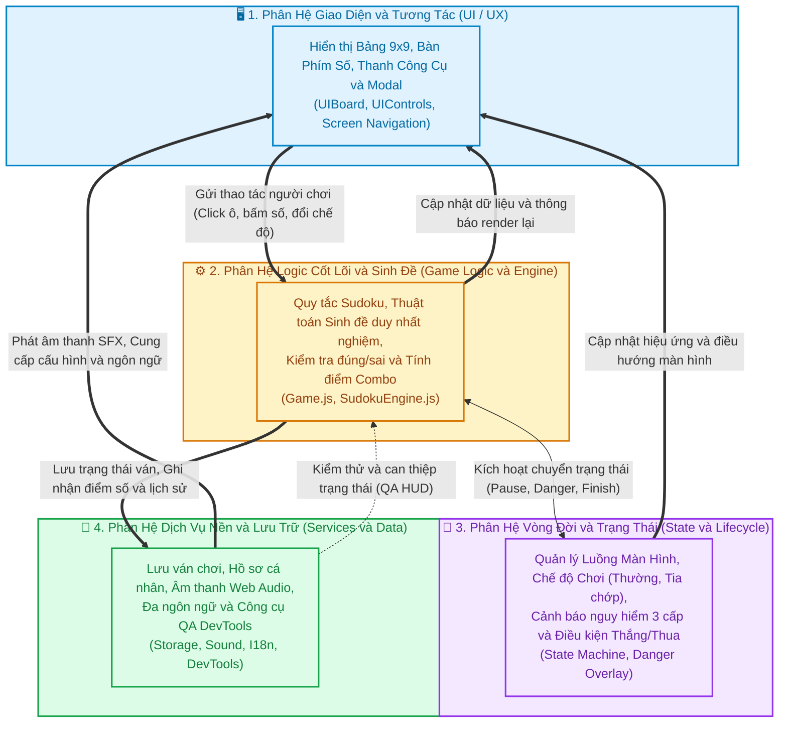

# 📐 Tài Liệu Kiến Trúc & Sơ Đồ Hệ Thống (Sudoku Game)

Chào mừng bạn đến với tài liệu kiến trúc toàn diện của dự án **Sudoku Game Web** (Vanilla JavaScript). 

Thư mục này cung cấp hệ thống sơ đồ trực quan được chuẩn hóa bằng **Mermaid.js**, giúp các lập trình viên, cộng tác viên và nhà phát triển nhanh chóng nắm bắt bức tranh toàn cảnh cũng như các luồng xử lý chi tiết bên trong trò chơi.

---

## 🗺️ 1. Sơ Đồ Tổng Thể Hệ Thống (Master System Map)

Sơ đồ tổng quan dưới đây mô phỏng sự tương tác giữa **4 phân hệ chính** của trò chơi mà không đi sâu vào chi tiết nội bộ. Bạn có thể bấm vào từng phân hệ để xem sơ đồ chuyên sâu tương ứng.

---

## 📚 2. Danh Mục Các Sơ Đồ Chi Tiết (Detailed Diagrams)

Để tránh các đường nét bị chồng chéo và đảm bảo tính mạch lạc, toàn bộ chi tiết nội bộ được chia tách vào 4 tài liệu chuyên đề dưới đây:

| STT | Tài liệu chuyên sâu | Nội dung mô hình hóa | Liên kết |
|:---:|:---|:---|:---:|
| **01** | **Kiến trúc Phân tầng Module** | Phân tầng Presentation, Business Logic và Infrastructure theo chuẩn Module Pattern (IIFE), danh sách API công khai và quan hệ phụ thuộc. | [Xem sơ đồ 01](01_component_architecture.md) |
| **02** | **Vòng đời & Máy trạng thái** | Sơ đồ chuyển đổi trạng thái (State Machine): Splash $\rightarrow$ Lobby $\rightarrow$ In-Game, các chế độ (Thường $\leftrightarrow$ Tia chớp $\leftrightarrow$ Notes) và cấp độ cảnh báo nguy hiểm (Stages 1-3). | [Xem sơ đồ 02](02_game_state_lifecycle.md) |
| **03** | **Luồng Dữ Liệu & Trình Tự** | Trình tự các bước (Sequence Diagram) khi: Điền số vào ô, Kích hoạt chế độ Tia chớp, và Thuật toán sinh đề duy nhất nghiệm có kiểm tra Backtracking. | [Xem sơ đồ 03](03_data_flow_and_sequences.md) |
| **04** | **Mô hình Dữ liệu & Chấm điểm** | Cấu trúc Schema lưu trữ trong LocalStorage (Game state, User profile, Settings) và đường ống tính toán điểm số (Base + Streak + Time - Penalties). | [Xem sơ đồ 04](04_storage_and_scoring_models.md) |

---

## 🛠️ 3. Quy Ước Thiết Kế Hệ Thống (Key Design Principles)

1. **Pure Vanilla JS (No Frameworks):** Toàn bộ ứng dụng chạy trực tiếp trên trình duyệt mà không cần webpack, npm build hay framework phụ thuộc nào.
2. **Module Pattern & Encapsulation:** Mỗi module đóng gói trong một IIFE closure, bảo vệ biến nội bộ và chỉ xuất ra các phương thức public cần thiết.
3. **Single Source of Truth:** `Game.js` đóng vai trò trung tâm lưu giữ trạng thái ván chơi (`state`), mọi thay đổi đều thông qua hàm tác vụ của `Game` và thông báo tới `UIBoard` / `UIControls` qua cơ chế Observer (`_notify`).
4. **Resilient Data Persistence:** Tự động lưu tiến trình sau mỗi nước đi vào `localStorage`, khôi phục nguyên vẹn khi tải lại trang hoặc đổi thiết bị.
